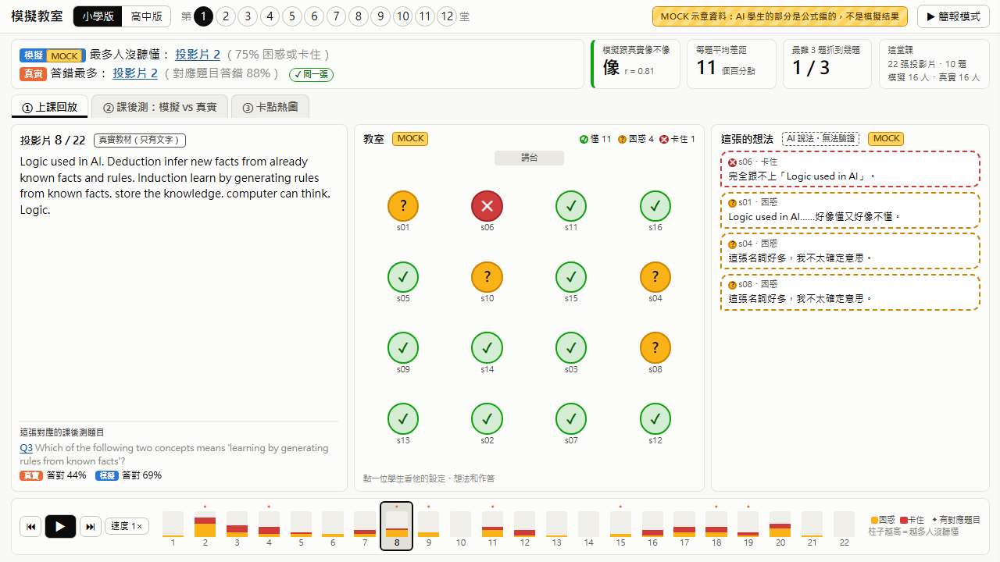
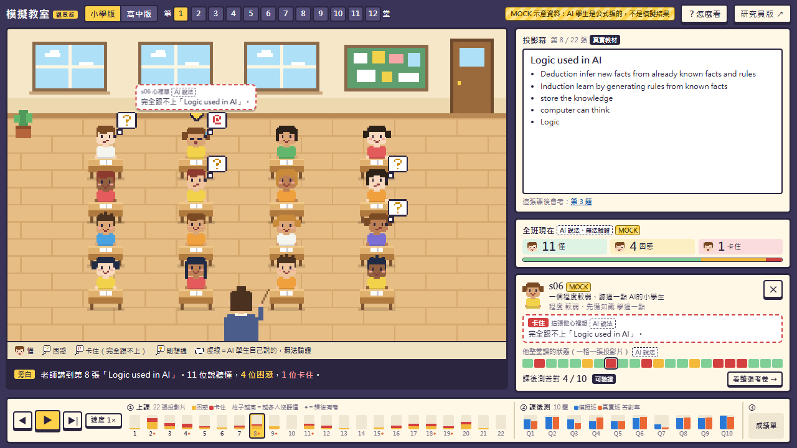

# 模擬教室（classroom_ui）

Gino 碩論的呈現介面原型：一群 AI 學生上了一堂課，卡在哪裡，跟真實班級像不像。

> **目前 AI 學生的部分全部是 MOCK 假資料**（`data/make_mock.py` 用公式編的，沒有用 LLM）。
> 真實的部分（投影片、題目、真實答對率）來自 Classroom Simulacra 公開資料。

有兩種前端，讀同一份資料、數字一致：

| 版本 | 網址 | 啟動 | 給誰 |
| --- | --- | --- | --- |
| **研究員版** | <http://localhost:8000/> | `start.bat` | 自己看數據：資訊密，三個分頁，有第 2 步、課前測、大熱圖 |
| **觀眾版** | <http://localhost:8000/game.html> | `start_game.bat` | 給一般人看、現場展示：像素風教室，一次只講一件事 |

研究員版：



觀眾版：



## 怎麼啟動

**雙擊 `start.bat`**。會開一個黑色視窗（本機伺服器）並自動打開瀏覽器到 <http://localhost:8000/>。關掉黑色視窗就停止。

或者手動：

```
cd C:\Users\GINO\Desktop\classroom_ui\classroom_ui
python -m http.server 8000
```

然後用 Chrome 開 <http://localhost:8000/>。

- 需要 Python 3（已經用 winget 裝了 3.12）。不需要安裝任何套件，不需要網路。
- **不能直接雙擊 `index.html`**：瀏覽器不允許這樣開的網頁讀資料檔，畫面會顯示「載入失敗」。
- 如果 8000 埠被占用，把指令和網址裡的 8000 都換成別的數字（例如 8123）。
- **觀眾版**用 `start_game.bat` 啟動時不用管這件事：它會自動換到下一個沒被占用的埠（8001、8002……），黑色視窗和瀏覽器的網址列會顯示實際的網址。手動啟動：`python serve.py game.html`。
- **開不起來時先檢查**：有沒有之前沒關掉的黑色視窗（舊的伺服器）。全部關掉再重開一次。

## 怎麼用

| 想做的事 | 怎麼做 |
| --- | --- |
| 選一堂課 | 左上角選「小學版／高中版」，再點 1–12 |
| 播放上課過程 | 「① 上課回放」分頁，按 ▶（或空白鍵）；← → 換投影片 |
| 看某個學生 | 點座位上的圓圈，或熱圖左邊的學生編號。右邊滑出他的設定、每張狀態、每題答案和理由。Esc 關閉 |
| 模擬 vs 真實 | 「② 課後測」分頁。藍色圓＝模擬，橘色菱形＝真實，淡橘色橫條＝真實的 95% 區間 |
| 課前 vs 課後 | 「② 課後測」分頁右上角按「課前測」 |
| 第 2 步示意 | 「② 課後測」分頁右上角按「第 2 步」 |
| 哪幾張投影片最卡 | 「③ 卡點熱圖」分頁 |
| 現場展示 | 右上角「簡報模式」（或按 P）。→ 或空白鍵下一步，Esc 離開 |
| 自我測試 | 開 <http://localhost:8000/#selftest>，會列出 48 項檢查的結果 |

網址 `#` 後面記錄了目前的畫面，可以把要展示的畫面存成書籤。

### 觀眾版怎麼用

| 想做的事 | 怎麼做 |
| --- | --- |
| 選一堂課 | 左上角選「小學版／高中版」，再點 1–12。學生會從門口走進來（右下角可以跳過） |
| 播放 | 最下面按 ▶（或空白鍵）。會依序走過 ① 每張投影片 → ② 每題課後測 → ③ 成績單。← → 一步一步走 |
| 跳到某一步 | 點最下面時間軸上的任何一格 |
| 看某個學生 | 點教室裡的小人。右下角出現他的設定、這一刻的想法、整堂課的狀態。Esc 關閉 |
| 看他的整張考卷 | 學生卡上的「看整張考卷」，或在成績單那一步點學生 |
| 每個符號的意思 | 場景正下方的圖例；右上角「？怎麼看」是完整說明 |
| 看詳細數據 | 右上角「研究員版」，會開到同一堂課 |
| 自我測試 | 開 <http://localhost:8000/game.html#selftest> |

網址加 `&intro=0` 可以跳過進場動畫（例：`game.html#school=e&lec=1&at=q3&intro=0`）。`at=` 後面是 `s8`（第 8 張投影片）、`q3`（第 3 題）或 `report`（成績單）。

換成真的模擬結果的方法跟下面一樣，兩個版本會一起換。

## 換成真的模擬結果

1. 讓模擬程式照 `docs/data_format.md` 的格式輸出 JSON，放進 `data/sim/`（檔名自訂，例如 `gpt4omini_elementary_L01_step1.json`）。`"source"` 欄位寫模型或實驗名稱，**不要含 MOCK 這四個字母**。
2. 在 `data/sim/index.json` 加一行：
   ```json
   {"school": "elementary school", "lecture_id": 1, "step": 1, "source": "gpt-4o-mini", "file": "data/sim/gpt4omini_elementary_L01_step1.json"}
   ```
3. 重新整理網頁。同一堂課有真的結果時會自動優先顯示，MOCK 標示會消失，右上角改顯示來源名稱。假資料檔不用刪。

每個學生要有每一張投影片的狀態和每一題的答案，否則數字會偏（詳見 `docs/data_format.md`）。

## 重新產生假資料

```
python data/make_mock.py
```

會覆蓋 `data/sim/MOCK_*.json` 和 `data/sim/index.json`。注意：這會把你手動加進 `index.json` 的那幾行洗掉，要重加。

## 檔案在哪裡

```
index.html          研究員版的頁面
start.bat           啟動研究員版
game.html           觀眾版的頁面
start_game.bat      啟動觀眾版
serve.py            start_game.bat 用的小伺服器（埠被占用會自動換）
css/game.css        觀眾版的樣式
js/game/sprites.js  觀眾版：像素畫（教室、小人、符號）
js/game/scene.js    觀眾版：場景、走路和小動作的動畫、滑鼠點到誰
js/game/game.js     觀眾版：狀態、右側面板、時間軸、旁白、自我測試
css/style.css       研究員版的樣式
js/stats.js         算數字（答對率、相關係數、區間），兩個版本共用
js/views.js         研究員版：畫三個分頁和學生面板
js/app.js           研究員版：狀態、點擊、播放、簡報模式、自我測試
data/
  lectures_real.json  真實資料（Gino 準備的）
  make_sample.py      產生上面那個檔（Gino 寫的，沒動）
  make_mock.py        產生假的模擬結果
  sim/                模擬結果檔＋index.json
docs/               所有文件，先看 progress.md
context/            背景資料副本（只讀）
external/           Classroom Simulacra 原始 repo 的副本（偵察報告驗證用，可以刪）
.venv/              驗證資料時用的 Python 環境（有 pandas，可以刪）
```
